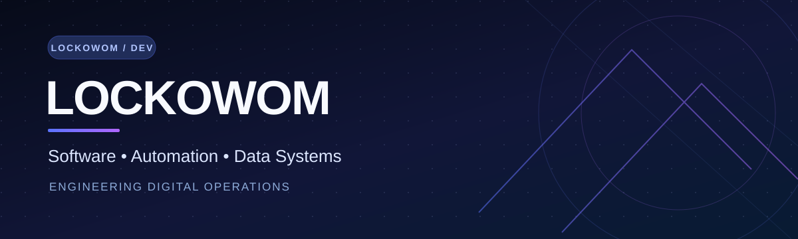

### Transformando operaciones reales en software inteligente
**Software Engineering · Logistics Technology · Inventory Intelligence · Automation**

[Español](#-sobre-mí) · [English](#-about-me) · [Proyectos](#-proyectos-destacados) · [Estadísticas](#-actividad-en-github)

---

## 👨‍💻 Sobre mí

Soy **Cristopher**, analista de inventario y creador de soluciones digitales con foco en **logística, control operacional y automatización de procesos** en Chile.

Conecto experiencia práctica en bodega e inventarios con desarrollo de software para construir herramientas que priorizan **trazabilidad, integridad de datos, usabilidad y escalabilidad**.

- **Áreas:** WMS/TMS, inventario, conteos, conciliación, despachos y automatización.
- **Enfoque técnico:** interfaces web, aplicaciones móviles, bases de datos, flujos offline y control de calidad.
- **Principios:** resolver necesidades operacionales reales, medir resultados y mantener sistemas auditables.

## 🧰 Stack y herramientas

## 🚀 Proyectos destacados

| Proyecto | Objetivo | Repositorio |
| :-- | :-- | :-- |
| **CCO PTM** | Plataforma de control operacional: WMS, TMS, inventario, calidad y postventa | [Explorar](https://github.com/Lockowom/CCO_PTM) |
| **Inventario** | Desarrollo de herramientas para procesos de inventario | [Explorar](https://github.com/Lockowom/inventario) |
| **INVEN3 (repositorio alternativo)** | Segundo repositorio público con documentación de INVEN3; no se presenta como producto distinto | [Explorar](https://github.com/Lockowom/Inventario-) |
| **Gym Stats Pro** | Aplicación desarrollada con TypeScript | [Explorar](https://github.com/Lockowom/gym-stats-pro) |

> Los enlaces anteriores corresponden a repositorios públicos. Los proyectos privados y la información interna no se exhiben.

### Arquitectura y decisiones técnicas

[**Explorar arquitectura técnica →**](docs/ARCHITECTURE.md) — diagramas de alto nivel basados en documentación pública, con límites explícitos sobre estado de despliegue y datos sensibles.

## 📊 Actividad en GitHub

Estadísticas generadas por servicios externos; pueden presentar limitaciones de disponibilidad o caché.

## 🌎 About me

I'm **Cristopher**, an inventory analyst and technology builder based in Chile. I develop software solutions inspired by day-to-day warehouse operations, inventory control and logistics workflows.

I focus on **operational visibility, traceability, data reliability and user-friendly systems**. My interests span web and mobile interfaces, PostgreSQL-backed applications, inventory reconciliation and process automation.

**Core mindset:** understand the operation, design carefully, validate with data, and improve continuously.

---

<strong>Engineering values / Principios de desarrollo</strong>

- **Data integrity:** prevent double counting, lost records and silent failures.
- **Operational traceability:** keep critical actions attributable and reviewable.
- **Security by design:** use least privilege and protect private business data.
- **Testable delivery:** prefer measurable improvements over unverified claims.
- **Human-centered workflows:** simplify complex tasks without removing oversight.

### Build systems that make operations better.

[Repositorios públicos](https://github.com/Lockowom?tab=repositories) · [Perfil](https://github.com/Lockowom)

